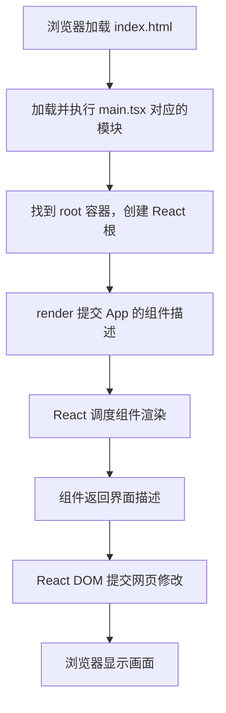
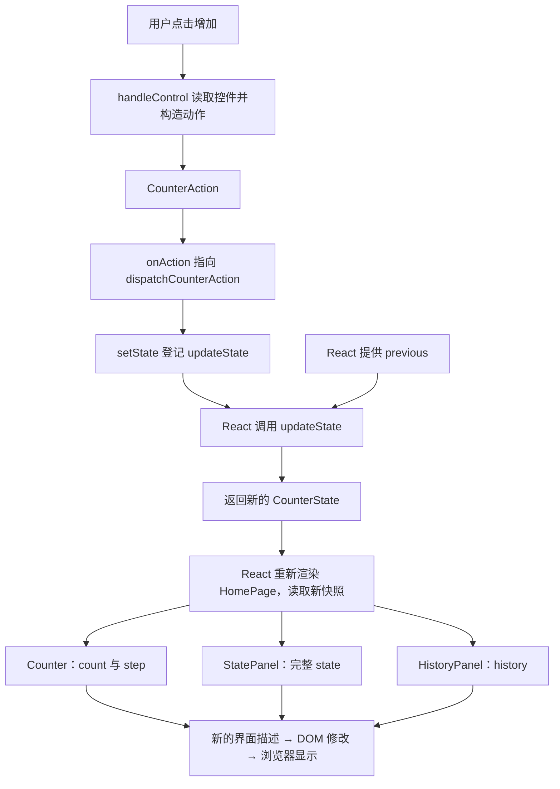

# React 教程：文件结构、调用关系与数据流

初稿：2026-10-11；归档与链接调整：2026-10-25。

本教程不讲 JavaScript、TypeScript 或 JSX 语法，重点回答三个问题：文件各自负责什么，谁调用谁，数据如何从一次操作变成画面。
以桌面已有的计数器为实例：[react-counter-demo 项目说明](示例/react-counter-demo/README.md)。
文中的实际结构根据源码核对；数值推演与练习属于预期行为，不冒充本次浏览器实测。

[返回前端学习索引](README.md) · [先看 JS 基础](JavaScript基础.md) · [学习清单](JavaScript科技树_学习清单.md)

## 1. React 在程序中负责什么

在这个浏览器项目中，业务代码根据状态描述界面，React 负责调度组件，React DOM 负责把结果落实到网页 DOM，浏览器再显示画面。

```text
用户操作 → 业务处理 → 新状态 → React 调用组件
                                   ↓
                               新的界面描述
                                   ↓
                           React DOM 更新网页
                                   ↓
                              浏览器显示画面
```

| 部分 | 职责 | 在本例的位置 |
|---|---|---|
| HTML | 提供网页入口、React 挂载容器和模块入口 | index.html |
| React | 管理组件的状态与渲染调度 | 组件及 useCounter 使用的框架接口 |
| React DOM | 创建网页中的 React 根，提交 DOM 修改 | main.tsx 的 createRoot 与 render |
| 业务逻辑 | 定义增加、减少、改步长、重置的行为 | useCounter.ts |
| CSS | 决定颜色、尺寸、间距与布局 | styles/ |
| TypeScript | 在开发和构建阶段检查类型 | types/ 与 tsconfig 文件 |
| Vite | 提供开发服务与生产构建 | package.json 与 vite.config.ts |

Vite 的开发服务器用于提供前端资源；本例没有业务后端或数据库。
浏览器接收到转换后的 JavaScript 与样式，不会直接把 TSX 源文件当作网页运行。
参见 [React DOM 的 createRoot](https://react.dev/reference/react-dom/client/createRoot) 与 [Vite 入门](https://vite.dev/guide/)。

## 2. 先把四种图分清楚

| 图 | 表达什么 | 不能据此断定什么 |
|---|---|---|
| 文件结构图 | 实现放在哪里、怎样分类 | 某文件一定调用同目录的另一个文件 |
| 组件嵌套树 | 页面由哪些组件组成 | 父组件直接执行了子组件函数 |
| 函数调用图 | 谁实际执行了谁，哪些是回调调度 | 数据一定沿同一条路线传递 |
| 数据流图 | 状态、动作、参数和结果怎样变化 | 图中的每一条箭头都是函数调用 |

导入一个模块，是获得其导出的能力或数据；不能仅凭导入关系画出函数调用树。
函数定义写在另一个函数里面，也不代表外层函数已经调用了它。

## 3. 完整文件结构与职责

下面是已有项目的文件结构，不是要求所有 React 项目照抄的固定模板。

```text
react-counter-demo/
├── index.html                 网页入口：root 容器与 main.tsx 入口
├── package.json               依赖和启动、检查、构建命令
├── package-lock.json          锁定依赖版本
├── .npmrc                     本项目的包源设置
├── .gitignore                 忽略依赖与生成物
├── vite.config.ts             开发与构建配置
├── tsconfig.json              TypeScript 配置入口
├── tsconfig.app.json          浏览器源代码的检查配置
├── tsconfig.node.json         Vite 配置等工具代码的检查配置
├── 启动示例.cmd               Windows 启动器
├── README.md                  运行说明与项目图解
├── src/
│   ├── main.tsx               接上 HTML 容器与 React 根
│   ├── App.tsx                根组件，声明首页
│   ├── vite-env.d.ts          开发环境类型声明
│   ├── pages/
│   │   └── HomePage.tsx       页面编排、取得状态、分发 Props
│   ├── components/
│   │   ├── Header.tsx         固定标题
│   │   ├── Counter.tsx        控件与事件入口
│   │   ├── StatePanel.tsx     显示状态快照
│   │   └── HistoryPanel.tsx   显示最近五条操作记录
│   ├── hooks/
│   │   └── useCounter.ts      组织状态与动作处理
│   ├── types/
│   │   └── counter.ts         动作、状态、记录的数据契约
│   └── styles/
│       ├── global.css         全局布局和基础样式
│       └── counter.css        计数器区域样式
├── figs/                      已有界面截图
├── node_modules/              已安装的依赖
└── dist/                      生产构建生成物
```

把它分为三个阅读区域：项目根目录解释“如何启动和构建”；src 解释“如何工作”；依赖、构建产物和截图用于运行与查看结果。
`types/counter.ts` 只声明类型，不保存状态，也不执行计算。

## 4. 启动以后，谁先执行



main.tsx 在模块入口执行挂载操作，App 负责声明 HomePage。
HomePage 被 React 调用时，直接调用 useCounter，取得状态快照与操作入口，并把需要的数据交给子组件。

这里的箭头表示启动流程，不表示 main.tsx 普通调用了所有组件函数。
React 调用组件来计算界面，随后才提交需要的 DOM 修改；组件重新执行也不意味着整个网页被删除重建。
参见 [React：渲染与提交](https://react.dev/learn/render-and-commit)。

## 5. 组件嵌套树：界面如何组成

```text
App
└── HomePage
    ├── Header          固定标题，不接收计数状态
    ├── Counter         接收 count、step、onAction
    ├── StatePanel      接收整个 state
    └── HistoryPanel    接收 history
```

这棵树只展示自定义组件，省略了中间的网页标签；它也不是最终 DOM 元素树。
这些组件函数由 React 调用。HomePage 描述需要这些子组件，并没有直接执行 Counter、StatePanel 或 HistoryPanel。

| 组件 | 读取什么 | 能发起什么 |
|---|---|---|
| Header | 固定文字 | 无计数动作 |
| Counter | 当前计数和步长 | 经 onAction 提交动作 |
| StatePanel | 完整状态快照 | 只展示 |
| HistoryPanel | 操作记录数组 | 只展示 |

Counter 不导入 StatePanel 来修改它，StatePanel 也不读取 Counter 内部变量。
它们显示的数据来自同一个上层状态来源。

## 6. 函数调用关系：普通调用与调度分开画

### 6.1 页面渲染时的普通调用

```text
React 渲染调度 → HomePage                 框架调用
                 └── useCounter          普通直接调用
                     └── useState        React 提供的 Hook 接口
```

useCounter 返回两项能力：这一轮的 state 快照，以及 dispatchCounterAction 函数。
返回一个函数，是把操作入口交给使用者，不表示现在就执行该函数。

### 6.2 用户操作时的调用

```text
React 事件系统 → Counter 中的 handleControl        框架事件调度
                 └── onAction                     普通调用
                     实际函数：dispatchCounterAction
                     └── setState                  React 状态更新接口

React 更新调度 → updateState(previous)             框架调用
                 └── 返回新状态                    无自有子函数调用
```

`onAction` 是 Counter 接收到的回调名称，实际指向 useCounter 返回的 dispatchCounterAction。
HomePage 负责把这个函数传给 Counter；点击时并不需要先普通调用一次 HomePage 才能提交动作。

dispatchCounterAction 内部定义 updateState，并把它交给 setState；updateState 由 React 调用，不能画成 dispatchCounterAction 直接执行 updateState。
回调登记与回调执行是两件事。事件处理函数是在对应交互发生时执行，而不是仅因组件渲染就执行。
参见 [React：响应事件与传递处理函数](https://react.dev/learn/responding-to-events)。

### 6.3 列表生成时的调用

```text
React 渲染调度 → HistoryPanel
                 └── history.map                  标准数组接口
                     └── renderEntry              由 map 逐条调用
```

renderEntry 每次读取一条记录，生成对应的列表项描述；它不是由 React 作为独立组件直接调度的。
一处 map 可调用回调多次；多次执行不等于有多个不同的调用者。

这些图按实际入口分别展开。不能为了画成一棵树，虚构一个同时直接调用渲染函数、事件函数和更新器的 main。

## 7. 输入、状态和输出的数据结构

本例没有外部接口输入。初始状态在 useCounter.ts 内部构造，运行中的输入来自按钮和步长选择框。

```text
用户操作
└── CounterAction
    ├── type: string       increase / decrease / reset / set-step
    ├── time: string       事件发生时生成的本地时间文字
    └── value: number      仅 set-step 动作携带新步长

CounterState
├── count: number          初始 0，允许负数
├── step: number           初始 1；界面选项为 1、2、5、10
├── totalActions: number   初始 0，每个已处理动作增加一次
└── history: HistoryEntry[]
    ├── 长度：0～5，最新记录在前
    └── 单条记录
        ├── id: number
        ├── label: string
        ├── before: number
        ├── after: number
        └── time: string
```

| 数据 | 来源 | 去向 |
|---|---|---|
| type、value、time | Counter 的 handleControl | dispatchCounterAction，再被更新器读取 |
| previous | React 提供的待处理前一状态 | updateState |
| 新 CounterState | updateState 的返回值 | React 保存，下一轮组件渲染读取 |
| count、step | HomePage 取得的状态 | Counter 的 Props |
| 整个 state | 同一份状态快照 | StatePanel 的 Props |
| history | 同一份状态中的记录 | HistoryPanel 的 Props |

Props 是父组件交给子组件的输入，既可以是显示数据，也可以是函数引用。
子组件调用回调提交意图，不代表它取得了随意修改父状态的权限。

## 8. 一次点击的完整数据流



假设操作前 count 为 3、step 为 2、totalActions 为 7，点击增加后，按源码规则推导：

| 项目 | 操作前 | 操作后 |
|---|---|---|
| count | 3 | 5 |
| step | 2 | 2 |
| totalActions | 7 | 8 |
| 最新记录 | 原来的第一条 | id 为 8，before 为 3，after 为 5 |
| history 长度 | 最多 5 条 | 添加新记录后仍最多 5 条 |

更新时间取自事件携带的 time。updateState 不在内部获取当前时间，也不修改 previous，而是计算并返回新状态。

这条链路表达状态更新的逻辑关系，不是保证所有节点在同一个同步调用栈中完成。
setState 提交更新后，当前处理函数里已有的 state 仍属于当前渲染快照；下一轮渲染才读取新的快照。
参见 [React：状态快照](https://react.dev/learn/state-as-a-snapshot)。

## 9. 为什么两个兄弟组件能同步显示

```text
                 HomePage 的同一份状态
                    /           \
          count、step             state
               ↓                  ↓
            Counter           StatePanel

Counter 的操作 → 父组件提供的回调 → 状态更新 → 两边取得新 Props
```

当两个组件需要协调数据时，将共同状态放在合适的共同父组件，再传递需要的数据和操作入口。
本例由 HomePage 调用 useCounter，两个显示区域读取同一来源，所以不需要相互调用来同步。
参见 [React：在组件之间共享状态](https://react.dev/learn/sharing-state-between-components)。

状态实际由 React 保存，并关联到对应的组件实例与 Hook 调用位置；它不是放在 hooks 文件夹里的全局数据库。
把 useCounter 分别放进两个组件调用，会分别得到各自的状态，不能仅凭使用同一个 Hook 文件认为状态已经共享。
自定义 Hook 复用的是组织状态逻辑的方式。参见 [React：复用有状态逻辑，而非自动共享状态](https://react.dev/learn/reusing-logic-with-custom-hooks#custom-hooks-let-you-share-stateful-logic-not-state-itself)。

## 10. 按你的结构要求组织 React

| 部分 | 安排方式 | 检查重点 |
|---|---|---|
| 页面组件 | 组织子组件，选择状态来源，分发数据与操作入口 | 不把全部业务细节塞在页面中 |
| 显示组件 | 按 Props 描述界面 | 不通过导入兄弟组件来修改其内部状态 |
| 事件入口 | 把交互转换为明确动作 | 登记真实回调目标，不隐藏业务调用 |
| 状态逻辑 | 根据动作与前一状态计算下一状态 | 数据契约、状态归属和更新时间清楚 |
| 通用工具 | 格式化、转换、校验等通用工作 | 可复用，但不反向触发业务或修改隐藏业务状态 |

已有示例没有独立工具库目录。将来需要共享工具时，可以增加 tools 分类；这是扩展建议，不是当前文件结构的一部分。
自定义 Hook 包含 React 状态生命周期要求，不能当作普通工具在任意事件回调中调用；Hook 应在组件或其他 Hook 的顶层调用。
参见 [React：自定义 Hook 与调用位置](https://react.dev/learn/reusing-logic-with-custom-hooks)。

检查业务调用树时，把普通业务调用边与框架调度边分开记录；检查完整关系时，再补上组件嵌套、工具依赖和数据流。
React 在内部遍历组件属于框架实现，不等于你的业务函数在递归调用自己。

## 11. 怎样读项目，怎样定位问题

推荐阅读顺序：

1. [index.html](示例/react-counter-demo/index.html)：找到网页容器与模块入口。
2. [main.tsx](示例/react-counter-demo/src/main.tsx)：找到 React 挂载点。
3. [App.tsx](示例/react-counter-demo/src/App.tsx)：找到根页面。
4. [HomePage.tsx](示例/react-counter-demo/src/pages/HomePage.tsx)：看状态交给了哪些组件。
5. [counter.ts](示例/react-counter-demo/src/types/counter.ts)：先认清动作、状态与记录的形状。
6. [Counter.tsx](示例/react-counter-demo/src/components/Counter.tsx)：沿 handleControl 找到动作入口。
7. [useCounter.ts](示例/react-counter-demo/src/hooks/useCounter.ts)：追踪动作如何产生新状态。
8. [StatePanel.tsx](示例/react-counter-demo/src/components/StatePanel.tsx) 与 [HistoryPanel.tsx](示例/react-counter-demo/src/components/HistoryPanel.tsx)：追踪新状态如何显示。

| 现象 | 沿哪条关系检查 |
|---|---|
| 点击没有效果 | 控件绑定 → handleControl → onAction 的实际目标 → 更新登记 |
| 两个区域数字不同 | 状态是否各存了一份；HomePage 是否传递了不同来源的数据 |
| 修改后读取的仍是旧值 | 是否在同一个事件处理中读取旧渲染快照 |
| 列表内容不对 | 新记录的字段 → history 更新 → HistoryPanel → renderEntry |
| 样式改变却不改变计数 | 样式与业务逻辑职责不同，这是正常现象 |
| 文件存在却没有出现在界面 | 是否进入了实际模块依赖和组件描述，而非只存在于目录 |

不要把函数日志次数当作用户操作次数。开发中的 StrictMode 可能额外执行组件或更新器来检查纯度；当前 main.tsx 没有使用 StrictMode 包裹组件树。
参见 [React：StrictMode](https://react.dev/reference/react/StrictMode)。

## 12. 用现有示例观察六个现象

启动 [启动示例.cmd](示例/react-counter-demo/启动示例.cmd)，访问启动窗口显示的地址。
命令、环境要求和构建说明以项目 README 为准。

以下是练习及按源码推导的预期结果：

1. 刷新后点增加三次：Counter 与 StatePanel 的 count 都应为 3。
2. 把步长改为 5：按钮文字改变，count 仍为 3，但改步长本身也是一次操作。
3. 再点增加：count 应为 8；观察记录中的 before 与 after。
4. 点减少两次：count 应为 -2，两个区域仍保持一致。
5. 点重置：count 回到 0，step 回到 1，操作次数与记录继续保留；刷新才恢复初始内存状态。
6. 只修改 Header 的文字或 CSS：观察界面内容或外观变化，沿文件职责判断为什么不用修改计数规则。

读完后，试着不看正文画出组件嵌套树、事件调用链与状态数据流，并给每条箭头标明“普通调用”“框架调度”或“数据传递”。

## 13. 本教程的核对范围

- 文件结构、函数名称、Props 分配、动作类型、状态字段和记录顺序均以现有源码核对。
- 源码事实与扩展建议分开表述；本例未实现后端、持久化、跨组件全局状态仓库或独立工具库。
- React 机制参考各节所链接的官方文档；目录安排是本例的组织方式，不是 React 强制标准。
- 2026-10-11 初稿核对源码与链接，未新增浏览器交互测试；2026-10-25 归档校验见 [本目录索引](README.md#本次整合与验证)。
