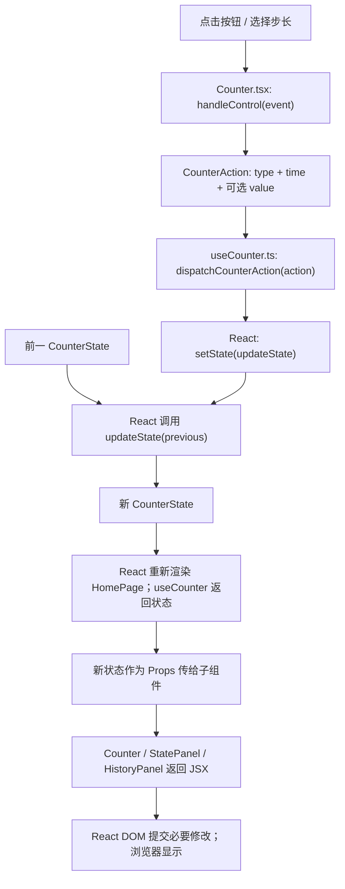
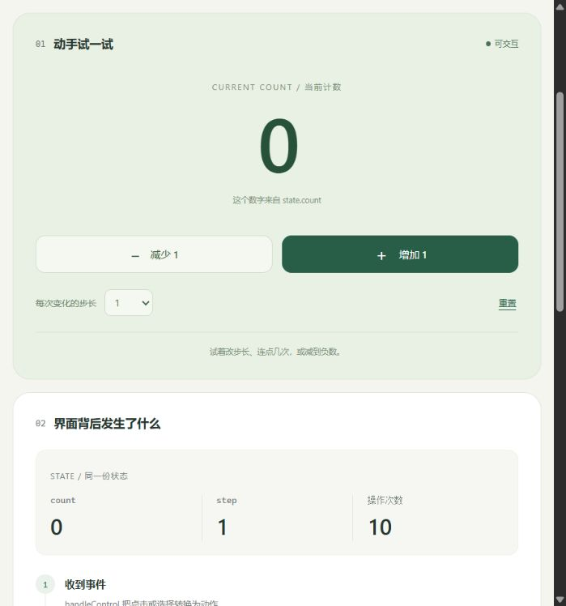

# React 入门示例：让状态变成界面

一个自包含的 React + TypeScript + Vite 学习单元，主题是“事件改变状态，状态决定界面”。
已实现：增加、减少、选择步长、重置、共享状态显示，以及最近五条操作记录。
计数允许负数；重置将计数设为 0、步长设为 1，操作次数和记录仍然保留。
刷新页面会恢复初始状态。运行时数据只保存在内存中。

## 1. 运行方法

需要 Node.js 22.12 或更新版本。本机运行时与实际验证结果见文末。

Windows 可以双击 **`启动示例.cmd`**。启动器在本文件夹运行，必要时执行 `npm ci`，
随后启动开发服务器并打开浏览器。终止服务器时，在启动窗口按 `Ctrl+C`。

也可以在本文件夹打开终端：

```powershell
npm ci
npm run dev
```

访问终端显示的地址，默认是 <http://127.0.0.1:5173>。
端口被占用时 Vite 会选择后续可用端口，因此以启动窗口显示的地址为准。
也可明确改用其他端口：

```powershell
npm run dev -- --port 5174
```

项目级 `.npmrc` 使用 `https://registry.npmmirror.com`，不修改全局 npm 配置。
若镜像不可用，单次命令可使用官方源：

```powershell
npm ci --registry=https://registry.npmjs.org
```

类型检查、生产构建与预览：

```powershell
npm run typecheck
npm run build
npm run preview
```

`build` 输出到 `dist/`，`preview` 的实际端口以终端为准。
开发源码应通过 Vite 访问；直接双击 `index.html` 不会自动把 TSX 转换成 JavaScript。
依赖的实际版本固定在 `package.json` 与 `package-lock.json`；可用 `npm ls --depth=0` 查看。

## 2. 文件结构与阅读顺序

本例的学习目标包含多文件协作，因此这些文件一起构成一个独立学习单元；
不依赖其他示例、共享仓库代码、模型 API、数据库或外部图片。

```text
react-counter-demo/
├── index.html                    HTML 入口：root 容器与模块入口
├── package.json                  依赖与 npm 命令
├── package-lock.json             依赖版本与完整性锁定
├── .npmrc                        本项目的 npm 镜像
├── .gitignore                    忽略依赖、构建产物与缓存
├── vite.config.ts                React 插件配置
├── tsconfig.json                 TypeScript 配置入口
├── tsconfig.app.json             浏览器代码类型检查
├── tsconfig.node.json            Vite 配置类型检查
├── 启动示例.cmd                  Windows 启动器
├── README.md                     本说明
├── src/
│   ├── main.tsx                  找 root 并挂载 App
│   ├── vite-env.d.ts             CSS 等资源模块的类型声明
│   ├── App.tsx                   根组件
│   ├── pages/HomePage.tsx        组织页面，读取 Hook，传递 Props
│   ├── components/
│   │   ├── Header.tsx            固定标题栏
│   │   ├── Counter.tsx           计数显示与交互控件
│   │   ├── StatePanel.tsx        共享状态与原理链路显示
│   │   └── HistoryPanel.tsx      把记录数组显示为列表
│   ├── hooks/useCounter.ts       初始状态与纯状态更新
│   ├── types/counter.ts          动作、记录、状态的类型
│   └── styles/
│       ├── global.css            全局布局与组件样式
│       └── counter.css           计数器的独立样式
├── figs/
│   ├── preview.jpg               实际浏览器视口截图
│   └── full-page.jpg             实际完整页面截图
├── node_modules/                 npm 安装生成
└── dist/                         npm run build 生成
```

本例没有后端通信，所以没有放置未实现的 services/api.ts；没有图标资源依赖，
也不建立空的 assets/public 目录。先读 `index.html → main.tsx → App.tsx → HomePage.tsx`，
再读 `Counter.tsx → useCounter.ts`，最后看类型与样式。

## 3. 输入数据结构与形状

没有外部数据集。初始状态由 `useCounter.ts` 构造；运行输入是按钮/下拉框事件。
输入是单条事件，不使用批次或张量。

```text
CounterState（一个对象）
├── count: number          初始 0，当前计数
├── step: number           初始 1，候选值 1 / 2 / 5 / 10
├── totalActions: number   初始 0，每个事件增加 1
└── history: HistoryEntry[]
    长度 0~5，最新记录在前
    └── 每条 { id:number, label:string, before:number, after:number, time:string }

一次用户操作
├── 按钮点击 → { type:'increase' | 'decrease' | 'reset', time:string }
└── 下拉选择 → { type:'set-step', value:number, time:string }
                 │
                 ▼
             CounterAction（一个对象）
                 +
             previous:CounterState（一个对象）
                 │
                 ▼
             新 CounterState → 各组件 Props → 页面文本与列表
```

`time` 是显示用的本地时间字符串，在事件处理阶段取值；更新函数只使用已提供的数据。
状态更新返回新对象、生成新数组，不修改旧状态。

## 4. 组件结构与真实调用关系

先区分两种关系：**组件树**是 JSX 的嵌套；**直接调用树**是函数实际调用谁。
`<Counter />` 描述一个组件，组件函数随后由 React 调用；它不等于 HomePage 直接执行 `Counter()`。

```text
组件树（组件函数由 React 调用）
App
└── HomePage
    ├── Header
    ├── Counter
    ├── StatePanel
    └── HistoryPanel
```

```text
直接调用与框架调度（第三方内部不展开）

main.tsx 模块入口
├── document.getElementById('root')      浏览器 API
├── createRoot(container)               React DOM API
└── root.render(<App />)                React DOM API，后续由 React 调度组件

React 渲染阶段 → HomePage()             框架调用
└── useCounter()                        本示例直接调用
    └── useState(INITIAL_STATE)          React API

React 事件系统 → Counter.handleControl(event)    框架调用
├── new Date().toLocaleTimeString(...)           标准接口
└── onAction(action) = dispatchCounterAction(action)
    └── setState(updateState)                   React API，登记更新器

React 更新调度 → updateState(previous)          框架调用，纯函数
└── 构造并返回新状态                            无本示例函数调用

React 渲染阶段 → HistoryPanel()                 框架调用
└── history.map(renderEntry)                     标准接口
    └── renderEntry(entry)                      由 Array.map 调用
```

其他组件 App、Header、Counter、StatePanel 返回 JSX，不直接调用其他示例函数。
所有控件复用唯一的 `handleControl`，它是 `dispatchCounterAction` 的唯一直接调用者。
框架调度和数组回调明确标注，不能冒充普通的直接函数调用。

## 5. 原理与代码对应



| 原理 | 本例对应位置 | 可以观察什么 |
|---|---|---|
| 组件 | App / HomePage / components 下的函数 | 标题、计数器、状态和记录各自封装 |
| Props | HomePage 的 JSX 参数 | 同一个 count 在计数器和状态面板同步出现 |
| State | useCounter 中的 useState | 事件发生后计数、步长、记录保留下来 |
| 事件 | Counter 中的 onClick / onChange / handleControl | 点击或选择会产生一个动作 |
| 函数式更新 | setState(updateState) | React 提供前一状态，据此计算新状态 |
| 列表渲染 | HistoryPanel 中的 history.map(renderEntry) | 记录变化后列表更新；id 用作 key |
| 样式 | global.css / counter.css | JSX 的 className 对应 CSS 选择器 |

React 管理状态调度、组件渲染与 DOM 提交；本例自己实现动作转换、计数规则和记录展示。
界面“步骤说明”展示机制，操作记录展示真实事件；它不是 React 内部执行次数的分析器。

## 6. 建议亲手做的小实验

1. 点击“增加 1”三次，观察左侧计数与右侧 `count` 都变成 3。
2. 把步长设为 5，再点击增加；计数变成 8，按钮也显示“增加 5”。
3. 点击减少两次，确认可以出现负数。
4. 点击重置，确认计数回到 0、步长回到 1；操作记录仍保留。
5. 修改 Header.tsx 的标题并保存，观察开发服务器更新界面。
6. 修改 counter.css 的按钮颜色，确认样式与计数逻辑独立。

## 7. 官方资料

- [React 快速入门](https://react.dev/learn)
- [State：组件的记忆](https://react.dev/learn/state-a-components-memory)
- [React 渲染与提交](https://react.dev/learn/render-and-commit)
- [Vite 入门与构建](https://vite.dev/guide/)

## 8. 实际验证记录

创建日期：2026-10-09。

| 环境 | 实测版本 |
|---|---|
| Node.js / npm | 24.21.0 / 11.19.0 |
| React / React DOM | 19.3.0 / 19.3.0 |
| Vite / React 插件 | 8.3.4 / 6.1.2 |
| TypeScript | 7.0.2 |

- 依赖安装完成，npm ls --depth=0 无缺失依赖；版本已锁定。
- npm run build 通过，包含 TypeScript 构建检查与 Vite 生产构建；输出在 dist/。
- npm run dev 成功提供页面，实际验证地址为 http://127.0.0.1:5173/。
- 实际浏览器操作：连续增加三次得到 3；选择步长 5，再增加得到 8；减少两次得到 -2。
- 重置后 count=0、step=1；操作记录保留最近五条；计数器和状态面板同步。
- 浏览器捕获的 error / warn 日志为空。
- 当前浏览器宽 699px，页面内容宽 699px，无横向溢出；已目视检查布局。
- 已提供 Windows 启动器；本次服务通过 npm run dev 启动，未额外执行桌面双击测试。
- 安装前 C 盘空闲约 135.94GiB，安装后约 135.56GiB；示例目录含依赖、构建产物约 78.4MiB。
  npm 缓存沿用已有配置，未修改全局 npm 设置或安装全局包。

下面是实际运行截图，不是设计稿。完整截图见 figs/full-page.jpg。




## 9. CoMind 归档说明

2026-10-25：源码、配置、锁文件和历史截图从已有桌面示例归档；原项目保持原样，依赖和构建产物不入库。第 8 节是创建时的历史记录，新的验证记录以 [前端资料索引](../../README.md#本次整合与验证) 为准。配套阅读：[React 调用关系与数据流](../../React教程_调用关系与数据流.md)。
