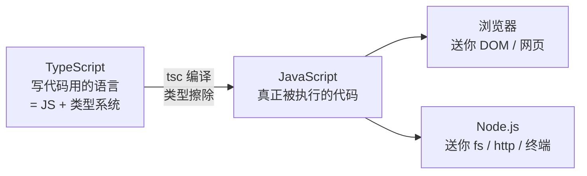
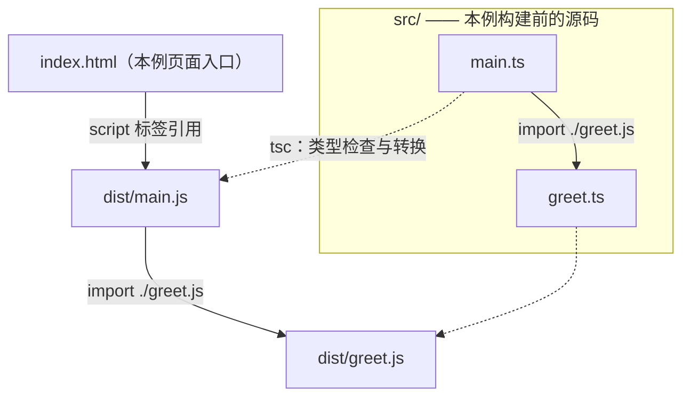
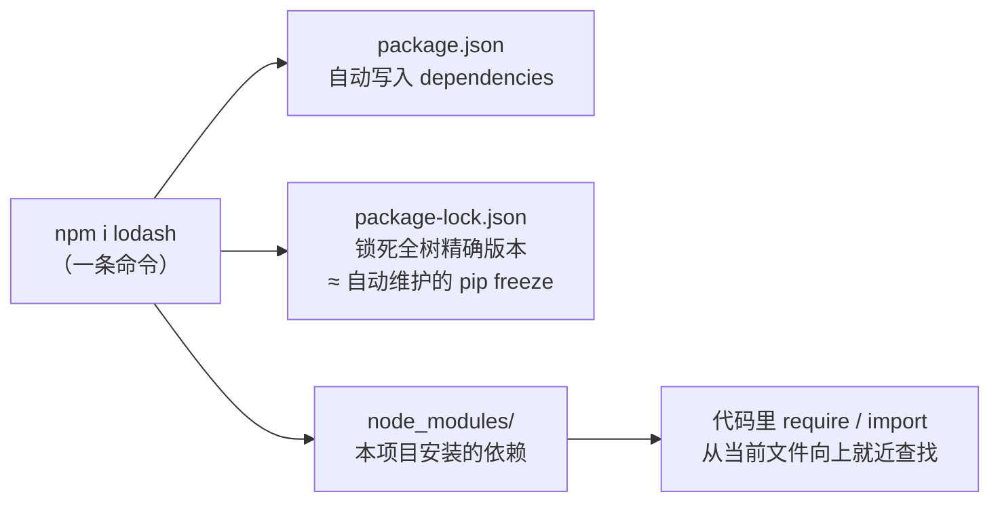
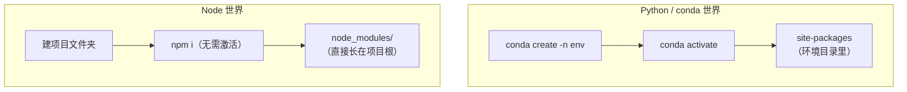

# JavaScript、TypeScript 与运行工具

> 📝 整理自 2026-10-04 与 AI 助手的讨论（只收自己感兴趣的部分）
> 2026-10-25：与桌面 JS 笔记、学习清单比对后保留本篇独有的运行机制与工程工具内容；语法入门见 [JavaScript 基础](JavaScript基础.md)，学习顺序见 [学习清单](JavaScript科技树_学习清单.md)。Mermaid 需使用支持该语法的预览器。

## 0. 一张图记住三者关系



> **一句话**：TypeScript 是"带类型外挂的 JavaScript"，Node.js 是"让 JS 脱离浏览器跑起来的运行时"。写的是 TS，跑的是 JS。

| 东西 | 身份 | 要点 |
|---|---|---|
| JavaScript | **语言** | 1995 年为浏览器生，动态类型；语言标准叫 **ECMAScript** |
| Node.js | **运行时** | = Chrome 的 JS 引擎 **V8** + libuv（事件循环/异步 IO）+ fs、http 等内置模块 |
| TypeScript | **语言 + 编译期类型系统** | 微软出品（C# 之父 Anders Hejlsberg）；以 JS 语法为基础；已有 JS 写法也可能触发 TS 类型检查错误 |

**类比锚点**：JavaScript : Node.js ≈ Python : CPython——语言 vs "让语言跑起来并送你标准库的东西"。浏览器是"另一个 CPython"：同一语言，但送的不是 `os/sys` 而是 `document/DOM`。

---

## 1. 类型擦除：类型只活在编译期

以下保留 2026-10-04 的历史演示记录：故意把声明为 `number` 的参数传成字符串。旧演示文件未收入本目录，也未在本次重新执行。

| 视角 | 命令 | 结果 |
|---|---|---|
| **运行时**（Node 24 直接跑 .ts） | `node ts_demo.ts` | ✅ 打印 `12` —— 类型标注被剥掉，JS 的 `+` 把 1 和 "2" 拼接 |
| **编译期**（tsc 检查） | `tsc --noEmit ts_demo.ts` | ❌ `error TS2345: string 不能赋给 number`，退出码 1 |

> **结论**：类型标注通常在转换时被擦除，不会自动验证运行时输入。开发时用类型检查发现问题，外部数据仍按接口契约校验。`enum` 等需要生成代码的 TS 特性不能简单归入“只删类型”。

支持内置类型擦除的 Node.js 版本可以直接运行只含可擦除语法的 `.ts`，但不会进行类型检查，也不会读取 `tsconfig.json` 来补齐转换能力；TSX 和需要生成代码的特性应使用适当的编译或运行工具。[Node.js：TypeScript 支持](https://nodejs.org/api/typescript.html)

---

## 2. HTML · JS · TS 的调用关系



**核心规律：普通浏览器执行 JavaScript；请求地址的后缀和响应内容是两件事。** Vite 开发页面可以写指向 `.ts` / `.tsx` 的入口，由开发服务器转换后返回可执行 JS。

- 图中的 `src/` 与 `dist/` 是一个编译部署示例；真实入口和输出位置取决于项目配置。
- 在采用对应 Node ESM 解析配置的 TS 项目中，源码可写运行时的 `.js` 导入路径，再由编译器映射到源文件检查；Vite 等工具的解析规则可能不同，按项目配置判断。
- 模块解析和类型检查不等于函数调用；源码写成 TS，实际函数仍在运行时执行。

**可借用 C 项目理解工具分工**（类比，不是同一运行机制）：`main()` ≈ `<script>` 入口 · `.c` ≈ `src/*.ts` · `.o/.exe` ≈ `dist/*.js` · gcc ≈ tsc · CMake ≈ Vite。

**“写 TS、跑 JS”的三种常见组织方式**（实际仓库也可能混合 JS、TS 和配置文件）：

| 形态 | 仓库放什么 | JS 产物去哪 |
|---|---|---|
| 经典网页 | `src/*.ts` | `dist/` 构建时生成，一般 `.gitignore` 掉（≈ 不提交 .exe） |
| Vite 项目 | 只有源码 | 开发阶段通常无需预先生成 `dist/`；生产构建时再按配置输出 |
| npm 库 | TS 源码（不发布） | 发布**编译后的 .js + `.d.ts` 类型声明**——**`.d.ts` 可类比头文件的声明作用，运行机制不同** |

> 看到 HTML 的模块地址以 `.ts` / `.tsx` 结尾时，先看是谁提供该资源。Vite 开发服务会转换内容；直接双击源 HTML 不会自动获得这项能力。[Vite 入门](https://vite.dev/guide/)

---

## 3. 包管理：npm（装 Node 自带）



```bash
npm init -y          # 初始化项目，生成 package.json
npm i lodash         # 装进"本项目"，自动记入 package.json
npm i -D typescript  # 本项目安装检查工具，再通过项目 scripts 执行
npm run dev          # 执行 package.json 里 scripts 定义的命令
```

- `package.json` = **requirements.txt + Makefile 合体**：记依赖 + 定义脚本命令和入口
- `package-lock.json` 记录依赖树和完整性信息；已有锁文件且与声明一致时，`npm ci` 按锁文件安装，不更新清单与锁文件。系统、Node 版本等仍需匹配项目要求。[npm ci](https://docs.npmjs.com/cli/v11/commands/npm-ci/)
- `node_modules/` 不提交；先读项目 README，再按其锁文件和包管理器选择安装命令。
- pnpm / Yarn 也是包管理工具；按项目已有配置使用，不同时混用多套锁文件。镜像设置属于项目或本机配置，不假定读者已经配置。

---

## 4. 包引入：require 与 import

引入来源三种，查找规则不同：

| 写法 | 找什么 | 规则 |
|---|---|---|
| `require('fs')` / `import fs from 'fs'` | Node **内置模块** | 不用装（fs/http/path…） |
| `require('lodash')` | **三方包** | 从当前文件向上逐级找 `node_modules/`（≈ sys.path 搜索） |
| `import {问好} from './greet.js'` | **本地文件** | 相对当前文件路径 |

两种语法是两代模块标准：`require`（CommonJS，Node 传统）vs `import`（ESM，现代标准）。**Node 中 `.mjs` 明确使用 ESM，`.cjs` 明确使用 CommonJS；`.js` 还要看最近的 `package.json` 等条件。** 包能否被某种写法加载取决于导出与兼容方式，不能从 lodash 的旧演示推断所有包都通用。[Node.js：模块判定](https://nodejs.org/api/packages.html)

---

## 5. 环境管理：没有 conda activate

**普通 npm 项目通常不需要像 venv 一样先激活环境。** 项目依赖一般安装在自己的 `node_modules/`，而当前终端采用哪个 Node 版本由安装路径或版本管理工具决定；一台电脑可以有多个 Node 版本。包目录隔离不能代替运行时版本与系统依赖管理。



| 你熟的 Python/conda | Node 世界 |
|---|---|
| conda create -n + activate | 普通 npm 项目通常省去激活步骤；运行时版本另行管理 |
| venv 的 site-packages | `node_modules/`（长在项目根） |
| requirements.txt（手维护） | package.json（npm 自动写入） |
| pip freeze 导出锁版 | package-lock.json（自动生成维护） |
| conda 管多版本 Python | 可选 nvm-windows / fnm / Volta 等 Node 版本管理工具；管理范围以具体工具为准 |
| conda base 里的 CLI 工具 | npm 的全局工具或项目内开发依赖；路径取决于配置 |

---

## 6. 历史案例：鲸鱼挂件的宿主分工

[DeepSeek-Balance-Whale-Widget](https://github.com/MeteorNOX/DeepSeek-Balance-Whale-Widget) —— DSH（DeepSeek Harness）的第三方插件，右下角鲸鱼娘盯 DeepSeek 余额。三个 JS 文件正好是本文全部概念的活标本：

| 文件 | 跑在哪 | 干什么 |
|---|---|---|
| `lib/index.js` | Node 宿主侧 | 注册 HTTP 路由、监听会话事件记账、管 API key 凭据 |
| `lib/accounting.mjs` | Node 宿主侧 | 记账内核：**金额全用整数定点（×10⁸）**——C 程序员的本能：浮点不能存钱；无交易接口就用余额快照差分（下降=消费，上升=充值） |
| `assets/whale-widget.js` | 浏览器侧 | 17294 行零框架 vanilla JS：DOM 注入 + 60 秒轮询 + 凸包命中检测 + Web Audio |

上表的文件名、行数与定点金额倍率来自 2026-10-04 的阅读记录，不代表上游当前版本；旧桌面副本已不作为本目录依赖，需要对照时从上游重新核对。

---


[返回前端学习索引](README.md)
